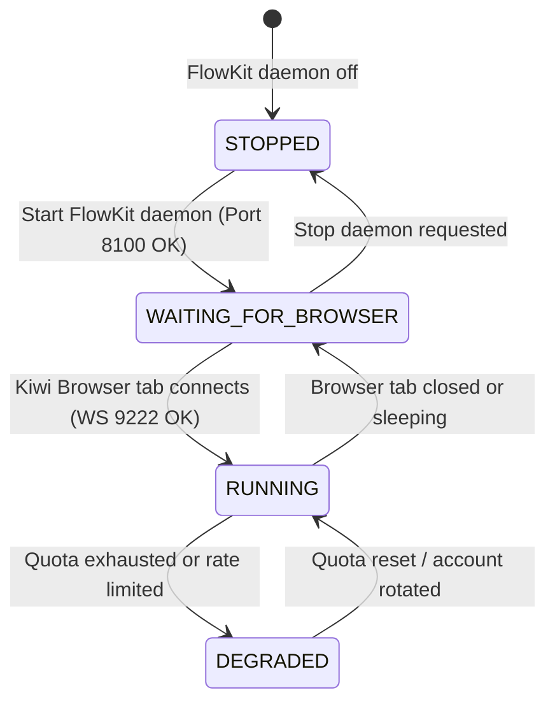

# Android Browser Compatibility & Google Flow Manifest V3 Extension Guide

## 1. Technical Problem Statement

FlowKit relies on a Manifest V3 Chrome Extension (`flowkit/extension/`) to automate video generation inside an authenticated tab at `flow.google.com`. The extension connects back to the FlowKit daemon via WebSocket at `ws://127.0.0.1:9222`.

### The Android Limitation
**Standard Google Chrome for Android DOES NOT support desktop Chrome Extensions (Manifest V2 or Manifest V3).**

Google intentionally restricts the mobile Android Chrome browser from loading unpacked extensions or running background extension service workers (`chrome.tabs`, `chrome.scripting`, `chrome.webRequest`).

---

## 2. Supported Android Browsers

To run the Google Flow automation extension natively on an Android device, the user must use a Chromium-based browser that supports desktop extensions:

| Browser | Manifest V3 Extension Support | Developer Mode / Unpacked Load | Recommendation |
| :--- | :--- | :--- | :--- |
| **Google Chrome (Android)** | ❌ No | ❌ No | Not supported for Flow extension |
| **Kiwi Browser** | ✅ Yes | ✅ Yes (Load unpacked from storage) | **RECOMMENDED** |
| **Lemur Browser** | ✅ Yes | ✅ Yes (Chrome + Edge store) | **RECOMMENDED (Alternative)** |
| **Yandex Browser with Alpha** | ⚠️ Partial | ❌ Sideload restricted | Not recommended |
| **Desktop Chrome / Edge** | ✅ Full | ✅ Yes | Supported when paired on local network |

---

## 3. Setup Instructions for Kiwi Browser on Android

1. Download **Kiwi Browser** from Google Play Store or GitHub releases.
2. In Kiwi Browser, navigate to `kiwi://extensions`.
3. Toggle the **Developer mode** switch in the top-right corner.
4. Tap **+(from .zip / .crx / .user.js)** or browse to unpacked directory `/root/ai-office/flowkit/extension`.
5. Verify that the **FlowKit Google Flow Assistant** extension appears and is enabled.
6. Open a new tab, navigate to `flow.google.com`, and sign in to one of your 3 authorized Google Pro accounts.
7. The extension will automatically detect the active Flow session and establish a WebSocket connection to `ws://127.0.0.1:9222`.

---

## 4. Graceful Degradation & State Machine

AI Office handles the browser connectivity state with resilient, non-blocking telemetry:

- When the browser tab is not connected, FlowKit status is reported as **`WAITING_FOR_BROWSER`**.
- In `WAITING_FOR_BROWSER` state, the AI Office organization continues running independent research, scriptwriting, and local FFmpeg stitching without throwing fatal errors.
- The Android Control Center UI displays a warning banner with quick setup steps so the Owner can open Kiwi Browser when ready to generate cloud video scenes.
