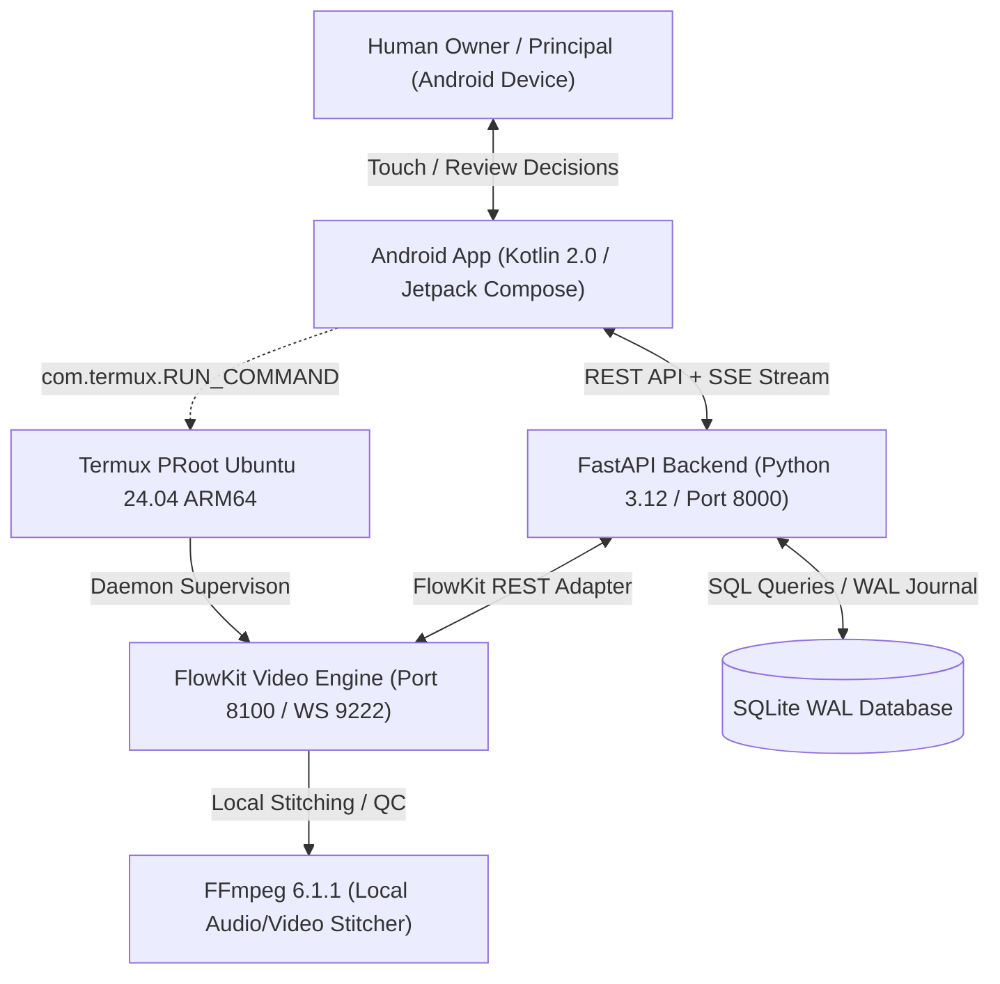

# AI Office — Autonomous AI Media Company Architecture

## 1. Executive Summary

AI Office v1.1.0 evolves from a general multi-agent organization into an **Autonomous AI Media Company**. The organization operates autonomously on Android 16 ARM64 + Termux Ubuntu 24.04 PRoot, powered by local and cloud AI models, FlowKit automated video generation, local FFmpeg video rendering, SQLite WAL database persistence, and an iOS-inspired Glassmorphism Android Native Control Center (Kotlin 2.0 + Jetpack Compose).

---

## 2. Governance & Core Hierarchy Invariant

$$\text{HUMAN OWNER / PRINCIPAL / FINAL APPROVER} \longleftrightarrow \text{NOVA PRIME (AI CEO / CENTRAL INTELLIGENCE)} \longleftrightarrow \text{DEPARTMENTS} \longleftrightarrow \text{SPECIALIST EMPLOYEES}$$

### 2.1 The Human Operator
- **Role**: Strictly **OWNER / PRINCIPAL / FINAL APPROVER**.
- **Boundaries**: The human user is **NOT** the operational CEO, task dispatcher, or departmental manager.
- **Authority**: Holds default-deny authority over external actions via the **NEEDS YOU** approval gateway (publishing content, spending funds, modifying credentials, or installing new external software tools).

### 2.2 Nova Prime — Central AI Executive
- **Role**: Central Autonomous Executive Intelligence of AI Office.
- **Capabilities**:
  - Analyzes market opportunities and content velocity.
  - Formulates editorial calendars and production strategies.
  - Directs departments and assigns tasks to specialist employees.
  - Dynamically evaluates employee performance and awards XP progression.
  - Prepares comprehensive publication packages for Owner approval.

---

## 3. Organizational Structure & Department Charters

| Department | Status | Director / Lead | Core Responsibilities |
| :--- | :--- | :--- | :--- |
| **Research & Opportunities** | **ACTIVE** | Dr. Aris Vance (Level 8) | Google Trends velocity scanning, competitor analysis, topic feasibility scoring, fact verification. |
| **Scriptwriting & Story** | **ACTIVE** | Marcus Reed (Level 8) | Hook engineering, narrative pacing, 3-act short-form scripts, visual scene prompt breakdowns, audio cues. |
| **Video Production & Editing** | **ACTIVE** | Elena Vance (Level 9) | FlowKit engine orchestration, video generation prompts, local FFmpeg stitching, subtitle burning, automated QC. |
| **Publishing & Distribution** | *PREP* | Sophia Chen (Level 8) | Metadata packaging (title, description, tags), scheduling, multi-channel packaging, submission to Needs You gateway. |
| **Audience Growth & Analytics** | *PREP* | Tariq Mansoor (Level 8) | Post-publication retention analysis, comment feedback synthesis, editorial recommendation loops. |

---

## 4. Workforce & Employee Level System

AI Office implements an authoritative 10-level progression system:
- **Level 1 (0 XP)**: Beginner / Trainee
- **Level 2 (100 XP)**: Trainee
- **Level 3 (250 XP)**: Junior Specialist
- **Level 4 (450 XP)**: Associate
- **Level 5 (700 XP)**: Intermediate
- **Level 6 (1000 XP)**: Advanced
- **Level 7 (1400 XP)**: Senior
- **Level 8 (1900 XP)**: Expert
- **Level 9 (2500 XP)**: Specialist Lead
- **Level 10 (3200+ XP)**: Professional Executive

### Real-Time Live Office Board
The Live Office Board tracks employee status in real-time via Server-Sent Events (SSE):
- `WORKING`: Actively executing an assigned session.
- `FREE`: Ready for task delegation.
- `WAITING_FOR_OWNER`: Blocked on a Needs You gateway decision.
- `STUCK`: Error encountered, automatically alerted to Nova Prime.
- `OFFLINE`: Inactive or scheduled downtime.

---

## 5. Technology Stack & Process Model

1. **Android Client**: Native Kotlin 2.0 Jetpack Compose application with premium iOS-inspired glassmorphism, 15 dedicated operational screens, and OkHttp SSE telemetry.
2. **Backend**: Python 3.12 FastAPI micro-architecture running on local loopback `127.0.0.1:8000`.
3. **Database**: SQLite WAL (Write-Ahead Logging) database `ai_office.db` with strict foreign keys, atomic transactions, and zero external database dependencies.
4. **Video Engine**: FlowKit engine running on `127.0.0.1:8100`, providing project management, batch generation, and local FFmpeg audio/video stitching.
