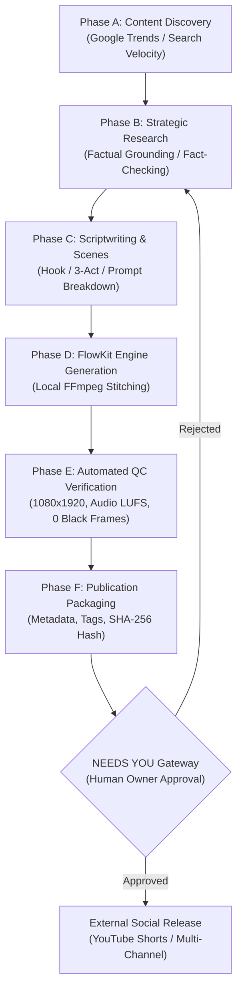

# Autonomous Audiovisual Media Production Pipeline (Phases A through F)

## 1. End-to-End Pipeline Workflow

The media company automates content production from raw velocity signals to fully packaged publication candidates through six rigorous phases:

---

## 2. Phase Breakdown

### Phase A: Content Discovery & Opportunity Scoring
- **Responsible**: Dr. Aris Vance & Maya Scribe (Research).
- **Process**: Identifies trending search terms, emerging technological breakthroughs, and high-velocity niche discussions.
- **Output**: Generates a `content_opportunities` record with `opportunity_score` (1-10) and `confidence_level`.

### Phase B: Strategic Research & Fact Verification
- **Responsible**: Research & Intelligence Department.
- **Process**: Compiles verified sources, key statistics, and counter-arguments to ground the video in factual evidence.
- **Output**: Research briefing linked to the project in `projects` table.

### Phase C: Scriptwriting & Scene Breakdown
- **Responsible**: Marcus Reed & Aria Lin (Scripts).
- **Process**: Formulates a compelling 3-second hook, high-retention body narrative, and actionable call-to-action (CTA). Breaks down narration into numbered `scenes` with visual generation prompts, duration targets, and audio cues.
- **Output**: Populates `scripts` and `scenes` tables.

### Phase D: FlowKit Video Generation & Audio Stitching
- **Responsible**: Elena Vance & Devin Cole (Editing).
- **Process**: Sends visual prompts to FlowKit engine on `http://127.0.0.1:8100`. FlowKit coordinates Google Flow generative video and uses local FFmpeg 6.1.1 on ARM64 PRoot to concatenate scenes, burn captions, and mix soundtrack audio.
- **Output**: Assembled master video file saved in `storage/rendered/`.

### Phase E: Automated Quality Control (QC)
- **Responsible**: Chloe Bennett (Editing / QC).
- **Process**: Executes automated video checks:
  - Resolution: 1080x1920 (9:16 vertical short-form).
  - Duration: 15s to 60s tolerance.
  - Audio: Normalization to -14 LUFS, zero digital clipping.
  - Visual: Zero consecutive black frames, aligned subtitle timing.
- **Output**: Records JSON verification report in `production_jobs.qc_report`.

### Phase F: Master Publication Package & Approval Gateway
- **Responsible**: Sophia Chen (Publishing) & Nova Prime (AI CEO).
- **Process**: Assembles multi-channel title, description, and SEO hashtags. Computes canonical SHA-256 payload hash and submits the package to the `approvals` table.
- **Output**: Transitions project to `WAITING_FOR_OWNER` and broadcasts `approval.created` SSE event to Android Control Center.
